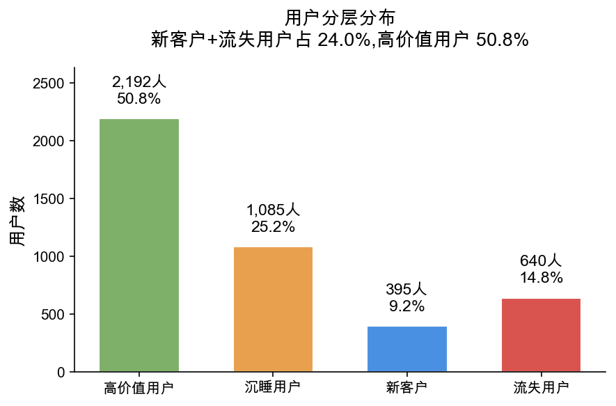
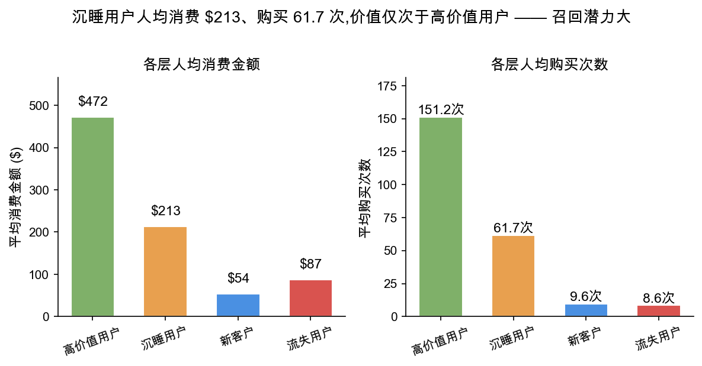

# 电商用户 RFM 分层与留存分析

> **基于真实电商购买数据,用 RFM 模型将用户分为四层,定位"留存"而非"拉新"才是核心问题,并给出分层运营策略。**

---

## 1. 业务问题

某电商平台拉新表现不错,但管理层想知道:

- 用户里哪些值得重点投入、哪些可以放弃?
- 现有用户结构是否健康?增长靠什么支撑?
- 营销预算应该投向拉新还是留存?

---

## 2. 数据说明

| 项目 | 详情 |
|---|---|
| 数据来源 | UCI Online Retail II 数据集|
| 数据链接 | https://archive.ics.uci.edu/dataset/502/online+retail+ii |
| 分析对象 | 产生过购买的独立用户 |
| 购买事件数 | 407,664 |
| 购买用户数 | 4,312 |
| 时间范围 | 2009-12-01 07:45:00 到 2010-12-09 20:01:00 |
| 快照日 | 2010-12-10(数据末日 +1,作为 recency 基准)|

---

## 3. 分析方法:RFM 模型

将每个用户用三个维度刻画:

- **R(Recency)**:距快照日的天数,逆向指标(越小越活跃)
- **F(Frequency)**:购买次数,正向指标
- **M(Monetary)**:总消费金额,正向指标

**打分逻辑(1-5 分):**

| 指标 | 打分方法 | 原因 |
|---|---|---|
| Recency | 分位数分箱(反转,小→5分)| 分布均匀,先 rank 打散重复值再 qcut |
| Monetary | 分位数分箱(大→5分)| 数值连续可分位 |
| Frequency | **业务规则手动分档** | 数据右偏非常严重（头部批发商拉高了很多），可以用qcut，也可以按照业务手动分 |

> **Frequency 分档**:1次=1分,5-17次=2分,18-43次=3分,44-101次=4分,≥102次=5分

**分层逻辑**:用 R、F 做四象限(分数 ≥3 为高):

| | F 高 | F 低 |
|---|---|---|
| R 高 | 高价值用户 | 新客户|
| R 低 | 沉睡用户 | 流失用户 |

---

## 4. 关键发现

### 发现 1:用户结构呈"漏水的桶",问题在留存不在拉新

| 分层       | 人数    | 占比    | 平均R    | 平均F    | 平均M  |
| -------- | ----- | ----- | ------ | ------ | ---- |
| 高价值用户    | 2,192 | 50.8% | 25.4天  | 151.2次 | 472.1 |
| 沉睡用户     | 1,085 | 25.2% | 169.6天 | 61.7次  | 212.9 |
| 新客户      | 395   | 9.2%  | 34.9天  | 9.6次   | 54.1  |
| 流失用户     | 640   | 14.8% | 211.7天 | 8.6次   | 87.2  |

**核心洞察:** 新客户(9.2%)和流失用户14.8%)合计 24.0%,且两者购买频率都极低(9.4-8.6 次)——本质是同一种"只买过一两次的低频用户",区别只是来得早晚。新客不复购就会滑向流失。

**这说明拉新并非瓶颈(拉新占 45% 说明能力很强),真正的问题是留存:大量用户来一两次就不再回来。** 平台像一个"漏水的桶"——上面拼命灌水(拉新),底下一直漏(留不住)。继续加大拉新只是往漏桶灌更多水。

### 发现 2:沉睡用户召回 ROI 最高

沉睡用户虽仅占 25.2%,但人均消费 $213、购买 61.7 次,价值仅次于高价值用户。他们有"已被验证的购买力"——曾经高频消费,说明产品满足过其需求,大概率被竞品/价格/生命周期暂时带走。

相比之下,流失用户本就低频低额,召回成本高且成功率低。**预算有限时,召回资源应优先投给沉睡用户,而非流失用户。**

---

## 5. 业务建议

1. **重点维护高价值用户（50.8%）"**:高价值用户已占一半以上，是当前收入的核心来源。建议提供会员权益、专属客服、优先发货等服务，防止他们滑向沉睡，这是性价比最高的动作。

2. **优先召回沉睡用户（25.2%）**:沉睡用户人均消费 $213、购买 61.7 次，历史价值仅次于高价值用户。他们曾经高频消费，说明产品是匹配的，只是暂时流失。
预算有限时，召回资源应优先投给沉睡用户，用专属优惠、新品提醒、限时礼包等方式唤醒，ROI 明显高于流失用户。

3. **对新客户做“首次复购”干预（9.2%）**:新客户平均只买了 9.6 次、消费 $54，仍处于早期。建议在首次购买后立刻推动第二单（优惠券、关联推荐、满减），帮助他们跨越“只买一次就离开”的临界点。

4. **流失用户采取低成本试探策略（14.8%）**:不投入重资源,用低成本批量触达试探,无响应则放弃。

---

## 6. 数据处理说明

- **Recency 基准**:数据无真实"今天",以数据末日 +1(2010-12-10)为快照日。真实业务中 RFM 应使用滚动近期数据,因用户状态随时间衰减。
- **未剔除高频高额用户**:这些用户经检查为真实大客户(recency 小、F/M 成正比),正是 RFM 要识别的高价值人群,剔除会违背分析目的。

---

## 7. 技术栈

- **Python**:pandas, numpy
- **可视化**:matplotlib
- **核心操作**:groupby 聚合、qcut 分位数分箱、业务规则分档
- **环境**:VSCode + Jupyter Notebook

---

## 8. 复现方式

1. 从 Kaggle 下载 [UCI EDU data]([https://www.kaggle.com/datasets/mkechinov/ecommerce-behavior-data-from-multi-category-store](https://archive.ics.uci.edu/dataset/502/online+retail+ii))
2. 生成 `events_sample.csv`,或将其放入文件夹
3. 打开 `用户画像.ipynb`,运行

---

## 9. 声明

本项目使用 Kaggle 公开数据集,仅供个人作品集与学习交流使用,不代表任何商业实体的实际业务情况。

---

## 10. 作者

- **姓名:** ruobai
- **邮箱:** ruobai404@gmail.com
- **GitHub:** [(https://github.com/ruobai-hash)](https://github.com/ruobai-hash)

